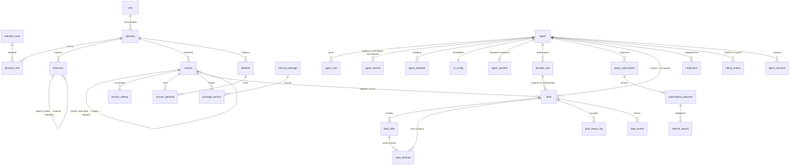

# Архитектура БД `mp_service`

Версия 0.7 от 25.10.2026. СУБД: PostgreSQL 15+ (проверено на 17.6). Текущая реализация v0.6 — `project_osm_map/db/mp_service.sql` (27 таблиц, 10 представлений, 6 функций, 9 триггеров проверки справочника). Здесь описана целевая схема v0.7 и изменения, которые нужно внести. Бизнес-правила — в [01_deal_algorithm.md](01_deal_algorithm.md).

## 1. Принципы модели

- **Типы таблиц:** DIM — справочник, LIST — реестр, LINK — связка, FAKT — факты/события.
- **Общие поля версионности** во всех таблицах, где это применимо: `date_creation`, `date_start`, `date_end` (`NULL` — бессрочно), `is_active` (0/1). Порядок — `sort_order`.
- **Новый сервис — только данными:** узел в `service`, тексты в `glossary` / `glossary_text`, поля в `service_attribute`, отличающиеся настройки в `service_setting`, включение в пакет в `package_service` (если категория ещё не в пакете).
- **Короткие списки значений** — строки общего справочника `dictionary` с полем `dict_type`, а не отдельные таблицы. Тип значения в колонке проверяет триггер `check_dict_type()`.
- **Параметры сервиса** — строки `service_setting`, наследуются вниз по дереву, могут зависеть от рейтинга; читаются функцией `get_setting()`.
- **Функции, читающие таблицы,** закреплены `SET search_path = mp_service`.
- **Бизнес-правила процесса сделки проверяет БД** (v0.7): переходы статусов, допустимость отклика, отзывы. API и приложение не могут их обойти.
- Скрипт `mp_service.sql` удаляет схему целиком (`DROP SCHEMA IF EXISTS mp_service CASCADE`) — только для разработки.

## 2. Группы таблиц и связи



| Группа | Таблицы |
| --- | --- |
| Языки, глоссарий, справочники | `interface_lang`, `icon`, `glossary`, `glossary_text`, `dictionary` |
| Конфигурация сервисов | `service`, `service_setting`, `attribute`, `service_attribute`, `service_package`, `package_service` |
| Агенты | `agent`, `agent_role`, `agent_service`, `agent_attribute`, `ui_config`, **`agent_position`**, **`provider_slot`** |
| Подписки и рефералы | `agent_subscription`, `subscription_payment`, `referral_reward` |
| Сделки и уведомления | `deal`, `deal_offer`, `deal_attribute`, `deal_status_log`, `deal_review`, `notification` |
| Рейтинг и санкции | `rating_history`, `agent_sanction` |

Итого в v0.7: **29 таблиц** (27 + 2 новые, выделены жирным).

## 3. Таблицы

Ниже — все таблицы с ключевыми колонками. Пометки: **[new]** — новая таблица или колонка v0.7, **[chg]** — изменение. Общие поля версионности не повторяются.

### 3.1 Языки, глоссарий, справочники

| Таблица | Тип | Ключ | Колонки |
| --- | --- | --- | --- |
| `interface_lang` | DIM | `interface_lang_id` | `language_code` (RUS, ENG, KAZ, DEU), `language_name` |
| `icon` | DIM | `icon_id` | `icon_code`, `icon_format` (`svg`/`png`), `icon_svg`, `icon_url`; одно из двух обязательно. SVG рисуется `currentColor`, **кроме курсоров карты** — у них цвет зашит в SVG |
| `glossary` | DIM | `glossary_id` | `glossary_code`, `icon_id` |
| `glossary_text` | DIM | `glossary_id + interface_lang_id` | `text_value`, `search_text` (синонимы) |
| `dictionary` | DIM | `dict_id` | `dict_type`, `dict_code`, `parent_dict_id`, `glossary_id`, `sort_order`, `value_num`, `value_text`, **[new] `value_json jsonb`** (шаблоны интерфейса, палитры) |

Диапазоны `glossary_id`: 10000+ сервисы, 20000+ атрибуты, 30000+ справочник, 40000+ пакеты, **[new] 50000+ тексты интерфейса** (`ui.*`), **[new] 60000+ уведомления** (`notify.*`).

### 3.2 Конфигурация сервисов

| Таблица | Тип | Ключ | Колонки |
| --- | --- | --- | --- |
| `service` | DIM | `service_id` | `parent_service_id`, `node_type` (`system`/`category`/`service`/`variant`), `glossary_id`, `sort_order` |
| `service_setting` | DIM | `setting_id` | `service_id` (NULL — платформа), `setting_code`, `rating_min`, `rating_max`, `setting_value`; уникальность `(service_id, setting_code, rating_min)` |
| `attribute` | DIM | `attribute_id` | `parent_attribute_id`, `attribute_type` (`group`, `text`, `number`, `mobile`, `email`, `date`, `datetime`, `card_token`, `card_exp`, `iin`, `car_number`, `address`, `photo`, `dim`, `par`), `glossary_id`, `sort_order` |
| `service_attribute` | LINK | `service_id + attribute_id` | `attr_scope` (`profile`/`request`/`offer`), `is_required`, `show_stage` (`always`/`never`/`agreed`/`near`), `sort_order` |
| `service_package` | DIM | `package_id` | `glossary_id`, `role_id`, `price`, `price_period`, `included_subagents`, `extra_subagent_price`, `trial_days`, `currency_code` |
| `package_service` | LINK | `package_id + service_id` | Категория в пакете включает все свои узлы |

Изменения в дереве услуг v0.7 (данные):
- такси (110): варианты Эконом (1101), Комфорт (1102), **[new] Комфорт+ (1103), Бизнес (1104)**;
- **[new]** сервис «Частная парковка» в категории «Транспорт и авто» с `max_parallel_deals` из ёмкости поставщика.

### 3.3 Агенты

**`agent`** (LIST, `agent_id`):

| Колонка | Тип | Смысл |
| --- | --- | --- |
| `interface_lang_id` | numeric FK | Язык интерфейса |
| `referrer_agent_id` | numeric FK | Кто пригласил |
| **[new] `is_testing`** | smallint 0/1 | Режим тестирования; допускается только при активной роли ADMIN (триггер `trg_agent_testing`) |

**`agent_role`** (LINK, `agent_id + role_id`): `role_id` → `ROLE` (CLIENT, PROVIDER, COMPANY, SUBAGENT, **[new] ADMIN**), `parent_agent_id` — компания субагента.

**`agent_service`** (LINK, `agent_id + service_id`) — подключённый сервис и настройки поставщика:

| Колонка | Тип | Смысл |
| --- | --- | --- |
| `geo_lat`, `geo_lon`, `zone_radius_m` | | Точка и зона обслуживания по умолчанию |
| `work_time_from`, `work_time_to` | time | Рабочее время для сервисов без публикаций (`slot_required = 0`) |
| `price_min`, `price_max` | numeric | Диапазон цены; для такси `price_min` — порог минимальной стоимости поездки (Н-7) |
| **[new] `unit_price_min`** | numeric(12,2) | Минимальная цена за единицу `price_unit` (км, час) |
| **[new] `capacity`** | numeric | Ёмкость (частная парковка); NULL — берётся `max_parallel_deals` |
| `client_rating_min` | numeric(3,2) | Минимальный рейтинг клиента |
| `is_auto` | smallint | Автоотклик |
| **[new] `assigned_by_agent_id`** | numeric FK | Компания, назначившая сервис субагенту; период — `date_start..date_end` (не позже окончания подписки компании, триггер) |

**`agent_attribute`** (FAKT, `agent_id + attribute_id + date_start`): значения полей профиля с историей. Атрибут 16 — псевдоним.

**`ui_config`** (LIST, `agent_id`): `config_json`, `checksum` = md5(`config_json::text`). Состав `config_json` в v0.7:

```json
{"lang": "RUS", "template": "A", "scheme": "LIGHT", "map": "OSM", "services": [100, 110], "version": 7}
```

**[new] `agent_position`** (FAKT, `agent_id`) — последнее положение агента:

| Колонка | Тип | Смысл |
| --- | --- | --- |
| `agent_id` | numeric PK FK | |
| `geo_lat`, `geo_lon` | numeric(9,6) NOT NULL | |
| `source` | text CHECK (`gps`, `manual`) | `manual` — курсор в режиме тестирования; допускается только при `agent.is_testing = 1` |
| `accuracy_m` | numeric | Точность GPS |
| `date_update` | timestamp NOT NULL | |

**[new] `provider_slot`** (FAKT, `slot_id`) — публикация доступности поставщика (Н-2):

| Колонка | Тип | Смысл |
| --- | --- | --- |
| `slot_id` | identity PK | |
| `agent_id`, `service_id` | FK, NOT NULL | Поставщик и узел дерева |
| `geo_lat`, `geo_lon` | numeric(9,6) | Точка (парковка) или точка А маршрута |
| `radius_m` | numeric | Радиус точки или ширина коридора rA |
| `geo_to_lat`, `geo_to_lon` | numeric(9,6) | Точка Б (такси) |
| `radius_to_m` | numeric | Радиус rB вокруг Б |
| `route_polyline` | text | Маршрут А → Б по дорогам OSM (encoded polyline, считает сервер) |
| `route_length_m` | numeric | Длина маршрута |
| `period_start`, `period_end` | timestamp NOT NULL | Окно доступности |
| `price_min` | numeric(12,2) | Минимальная цена по этой публикации |
| `slot_status` | text CHECK (`active`, `closed`, `cancelled`) | |
| `date_creation` | timestamp | |

### 3.4 Подписки и рефералы — без изменений

`agent_subscription` (периоды, пробный период один раз на агента), `subscription_payment` (`paid`/`failed`/`refund`), `referral_reward` (`pending` → `accrued` → `paid_out`, `cancelled`). Представление `v_agent_available_service` меняется (раздел 6).

### 3.5 Сделки и уведомления

**`deal`** (FAKT, `deal_id`):

| Колонка | Тип | Смысл |
| --- | --- | --- |
| `deal_id` | **[chg] identity** | |
| `service_id` | FK | Вариант услуги |
| `client_agent_id`, `provider_agent_id` | FK | Поставщик — после согласования |
| **[new] `slot_id`** | FK `provider_slot` | Запрос создан из публикации |
| `deal_status_id` | FK → `DEAL_STATUS` | Меняется только по таблице переходов |
| `payment_method_id` | FK → `PAYMENT_METHOD` | Сейчас `DIRECT` |
| `geo_lat`, `geo_lon` | | Точка клиента / точка подачи П |
| `zone_radius_m` | | Радиус зоны клиента |
| `geo_to_lat`, `geo_to_lon` | | Точка назначения Н |
| **[new] `route_length_m`** | numeric | Длина П → Н по дорогам (такси) |
| `period_start`, `period_end` | | CHECK `period_end > period_start` |
| `price_forecast_min`, `price_forecast_max` | | Прогноз |
| **[new] `client_price`** | numeric(12,2) | «Моя цена» клиента (Н-1) |
| `provider_rating_min` | | |
| `price_provider`, `fee_amount`, `price_total` | | Фиксируются при согласовании |
| **[chg] `close_secret`** (было `qr_token`) | text | Секрет кода закрытия, создаётся при AGREED, клиенту не отдаётся |
| **[new] `date_agreed`** | timestamp | Для окна бесплатной отмены |
| `date_close` | timestamp | CHECK `date_close >= date_creation` |

**`deal_offer`** (FAKT, `deal_offer_id`):

| Колонка | Тип | Смысл |
| --- | --- | --- |
| `deal_offer_id` | **[chg] identity** | |
| `deal_id`, `provider_agent_id` | FK | UNIQUE (`deal_id`, `provider_agent_id`) |
| `offer_price` | numeric(12,2) NOT NULL | |
| `offer_mode` | `auto` / `manual` | |
| `geo_lat`, `geo_lon` | | Точка предложения (место, машина) |
| **[chg] `offer_status`** (вместо `is_selected`) | text CHECK (`active`, `selected`, `declined`, `withdrawn`, `expired`) | Частичный уникальный индекс: один `selected` на сделку |
| **[new] `spot_number`** | text | Номер места (частная парковка) |
| `date_creation` | timestamp | |

**`deal_attribute`** — поля запроса (`deal_offer_id` NULL) и отклика; без изменений.

**`deal_status_log`** — **[chg] пишет только триггер** `trg_deal_status`; `deal_status_log_id` identity; `cancel_reason_id` обязателен для CANCEL_CLIENT и CANCEL_PROVIDER (`cancel_reason_id` или `comment`).

**`deal_review`** (`deal_id + from_agent_id`): `to_agent_id`, `to_role_id`, `score` 1–5, `comment`. **[new] триггер** `trg_deal_review`: сделка в CLOSED или CANCEL_CLIENT/PROVIDER, автор — сторона сделки, адресат — другая сторона.

**`notification`**: `notify_type_id` → `NOTIFY_TYPE`, `channel` (`push`/`sms`/`email`/`in_app`), `payload jsonb`, `date_sent`, `date_read`. **[chg]** `notification_id` identity.

### 3.6 Рейтинг и санкции — без изменений структуры

`rating_history` (по дням для пары «роль + сервис»; total = 0,5 × system + 0,5 × review), `agent_sanction` (`warning`/`rating_down`/`block`, `block_level` 1–3 — неделя, месяц, год).

## 4. Общий справочник `dictionary`

| `dict_type` | Значения | Использование |
| --- | --- | --- |
| `ROLE` | CLIENT, PROVIDER, COMPANY, SUBAGENT, **ADMIN [new]** | Роли агентов, пакеты, рейтинг |
| `DEAL_STATUS` | INIT, MATCHING, OFFERS, AGREED, CONTACT, CLOSED, CANCEL_FREE, CANCEL_CLIENT, CANCEL_PROVIDER, EXPIRED, **NOT_CLOSED [new]** | `value_num = 1` — финальный статус |
| **`DEAL_TRANSITION` [new]** | `<ИЗ>__<В>`, например `OFFERS__AGREED` | Допустимые переходы: `parent_dict_id` — статус «из», `value_num` — id статуса «в», `value_text` — кто выполняет (`client`/`provider`/`system`) |
| `CANCEL_REASON` | PLANS, LATE, SILENT, OTHER | Причины отмены |
| `PAYMENT_METHOD` | DIRECT, PLATFORM | Способ оплаты сделки |
| `NOTIFY_TYPE` | NEW_OFFER, AGREED, CANCELLED, NEAR, SUB_END; **[new]** NEW_REQUEST, OFFER_WITHDRAWN, CLOSE_REQUEST, CLOSE_CODE, CLOSING_ASK, REVIEW_REQUIRED, EXPIRED, SANCTION | Типы уведомлений |
| `SANCTION_REASON` | BYPASS_GEO, NEAR_CANCEL, FAKE_REVIEWS, FAKE_REFERRALS, REVENUE_DROP | Причины санкций |
| `REFERRAL_LEVEL` | 1, 2, 3 (10%, 5%, 2%) | Уровни рефералов |
| `MAP_BASE_LAYER` | OSM_OFFLINE_ALMATY, OSM | Подложка карты |
| `MAP_ROUTE_LINK` | YANDEX, 2GIS, GOOGLE | Шаблоны ссылок на маршрут |
| **`MAP_CURSOR` [new]** | CLIENT, PROVIDER, CLIENT_TEST, PROVIDER_TEST | Курсоры карты: `glossary_id` → `icon_id`; «капля» и «капля с шестерёнкой», цвет зашит в SVG |
| **`UI_TEMPLATE` [new]** | A, B, C | Шаблон интерфейса: `value_json` — раскладка (раздел 7) |
| **`UI_SCHEME` [new]** | LIGHT, DARK (у каждого шаблона свои) | Цветовая схема: `parent_dict_id` → шаблон, `value_json` — палитра. Коды уникальны: `A_LIGHT`, `A_DARK`, `B_LIGHT`… |

Триггер `check_dict_type()` остаётся на тех же 9 таблицах; новые колонки-статусы (`deal_offer.offer_status`, `provider_slot.slot_status`) — текстовые с CHECK.

## 5. Настройки `service_setting`

Значение ищется от узла вверх по дереву до платформы (`service_id IS NULL`), с учётом рейтинга поставщика (`rating_min` ≤ рейтинг < `rating_max`).

| Код | Платформа | Переопределения | Назначение |
| --- | --- | --- | --- |
| `geo_mode` | point | доставка (20), такси (110) — route; репетитор (180) — none | Тип гео |
| `place_mode` | provider | доставка (20), дом и ремонт (30), такси (110) — client; красота (40) — provider; репетитор (180) — online | Правило зоны |
| `price_unit` | fixed | парковка (100), грузоперевозки (120), дом и ремонт (30), репетитор (180) — hour; такси (110) — km; мастер на час (140) — fixed | Единица цены |
| `offer_sort_1..3` | rating:desc, price:asc, distance:asc | парковка — distance:asc, rating:desc, price:asc; такси — distance:asc, rating:desc, **[chg] price:asc**; красота — rating:desc, distance:asc | Порядок откликов |
| `near_radius_m` | 300 | такси — 200 | Радиус CONTACT |
| `approx_offset_m` | 0 | парковка: <4,0 — 100; 4,0–4,5 — 75; ≥4,5 — 50 | Смещение точки |
| `deal_fee_percent` | 0 | — | Сбор со сделки |
| `forecast_window_min`, `forecast_grid_m` | 30, 500 | парковка — окно 15 | Прогноз цены |
| `rating_weight_system`, `rating_weight_review` | 0,5 и 0,5 | — | Веса рейтинга |
| `currency` | KZT | — | Валюта |
| `map_pack_refresh_days` | 30 | — | Обновление офлайн-карты |
| **`slot_required` [new]** | 0 | парковка (100), частная парковка, такси (110) — 1 | Нужна публикация окна |
| **`max_parallel_deals` [new]** | 1 | частная парковка — из `agent_service.capacity` | Одновременные сделки |
| **`accepts_variants` [new]** | — | Комфорт (1102) — `1101`; Комфорт+ (1103) — `1101,1102`; Бизнес (1104) — `1101,1102,1103` | Какие классы берёт машина |
| **`close_method` [new]** | QR | репетитор (180) — KEY | Способ закрытия |
| **`close_qr_ttl_s` [new]** | 10 | — | Время жизни QR |
| **`close_key_ttl_s` [new]** | 60 | — | Время жизни ключа |
| **`close_code_len` [new]** | 6 | — | Длина кода |
| **`cancel_free_min` [new]** | 5 | такси — 2 | Окно бесплатной отмены |
| **`closing_ask_after_min` [new]** | 30 | — | Вопрос «Услуга оказана?» после конца периода |
| **`not_closed_after_h` [new]** | 24 | — | Переход в NOT_CLOSED |
| **`rating_start` [new]** | 4.0 | — | Рейтинг клиента без истории |
| **`auto_price_round` [new]** | 50 | — | Округление цены автоотклика |
| **`position_ttl_s` [new]** | 120 | — | Положение старше считается неизвестным |

## 6. Функции, триггеры, представления

### 6.1 Существующие (v0.6)

| Объект | Назначение |
| --- | --- |
| `check_dict_type()` + 9 триггеров | Тип значения общего справочника |
| `dict_id(type, code)` | Id значения справочника |
| `geo_distance_m(lat1, lon1, lat2, lon2)` | Расстояние по прямой (гаверсинус) |
| `offer_sort_key(spec, distance, rating, price)` | Ключ сортировки отклика |
| `get_setting(service_id, code, rating)` | Значение настройки по дереву |
| `service_base_id(service_id)` | Узел уровня «сервис» |
| `v_service_tree` | Узел и все предки |
| `v_service_search` | Поиск услуг на языке |
| `v_service_attribute_effective` | Поля узла с наследованием |
| `v_attribute_label` | Подписи полей и пиктограммы |
| `v_agent_available_service` | Сервисы по подписке |
| `v_subscription_charge` | Абонплата с субагентами |
| `v_agent_finance_daily`, `v_company_finance_daily` | Доходы и расходы |
| `v_deal_offer_list` | Отклики в порядке вывода, смещённые точки |
| `v_deal_offer_route` | Ссылки на маршрут после согласования |

### 6.2 Новые и изменённые (v0.7)

| Объект | Сигнатура / тип | Назначение |
| --- | --- | --- |
| `agent_rating(agent, role, service, on_date)` | function → numeric | Последний `total_rating`; для клиента без истории — `rating_start` |
| `provider_can_offer(deal_id, agent_id)` | function → `(ok boolean, reason text)` | Все условия подбора п. 2.1–2.9 алгоритма, кроме маршрута такси (его проверяет сервер, раздел 8) |
| `v_deal_candidates` | view | Сделки MATCHING/OFFERS × поставщики, для которых `provider_can_offer` = true; источник входящих запросов и автооткликов |
| `price_forecast(service_id, lat, lon, period_start)` | function → `(min, max, median)` | Прогноз цены (П-5) |
| `trg_deal_status` | BEFORE UPDATE OF `deal_status_id` ON `deal` | Проверяет переход по `DEAL_TRANSITION`, причину отмены, CONTACT для гео-услуг перед CLOSED; пишет `deal_status_log` (агент — из `current_setting('mp.agent_id', true)`) |
| `trg_deal_offer_check` | BEFORE INSERT ON `deal_offer` | `provider_can_offer`; сделка в MATCHING/OFFERS; переводит сделку в OFFERS при первом отклике |
| `uq_deal_offer_selected` | UNIQUE INDEX (`deal_id`) WHERE `offer_status = 'selected'` | Один выбранный отклик |
| `trg_deal_review` | BEFORE INSERT ON `deal_review` | Сделка в финальном статусе; автор и адресат — стороны сделки |
| `trg_agent_testing` | BEFORE INSERT OR UPDATE ON `agent` | `is_testing = 1` только при активной роли ADMIN |
| `trg_agent_position` | BEFORE INSERT OR UPDATE ON `agent_position` | `source = 'manual'` только при `is_testing = 1` |
| `trg_agent_service_assign` | BEFORE INSERT OR UPDATE ON `agent_service` | Для субагента: сервис в пакете компании, `date_end` ≤ окончания подписки компании |
| `agent_pending_reviews(agent_id)` | function → int | Число сделок без баллов агента; > 0 блокирует создание запроса и отклика |
| `v_agent_available_service` **[chg]** | view | Добавлены субагенты: сервисы, назначенные компанией (`assigned_by_agent_id`), ∩ пакет действующей подписки компании |
| `v_deal_offer_list` **[chg]** | view | `offer_status IN ('active','selected')`; угол смещения `md5(deal_offer_id || current_setting('mp.geo_secret'))`; расстояние до согласования — интервалом (`distance_band`: `0-50`, `50-100`, `100-200`, `200+`) |
| `v_provider_slot_map` | view | Активные публикации для карты клиента: смещённая точка, псевдоним, рейтинг, мин. цена, окно |
| `v_ui_options` | view | Пары «шаблон / схема» с подписями на языке — для выпадающего списка (`A / Светлая`, `A / Тёмная`, …) |
| `v_map_cursor` | view | Курсор для агента: роль × `is_testing` → SVG |

Секрет смещения `mp.geo_secret` задаёт API-сервер в каждой сессии (`SET mp.geo_secret = …` из переменной окружения `MP_GEO_SECRET`); в БД не хранится.

### 6.3 Плановые задания (выполняет сервер, раз в минуту)

| Задание | SQL-логика |
| --- | --- |
| Истечение | MATCHING/OFFERS с `period_start <= now()` → EXPIRED; активные отклики → `expired` |
| Вопрос о закрытии | AGREED/CONTACT, `period_end + closing_ask_after_min <= now()`, уведомление ещё не отправлено → `CLOSING_ASK` обеим сторонам |
| NOT_CLOSED | AGREED/CONTACT, `period_end + not_closed_after_h <= now()` → NOT_CLOSED; если в истории есть CONTACT — санкционный сигнал `BYPASS_GEO` |
| Сближение | AGREED, расстояние между `agent_position` сторон ≤ `near_radius_m`, положения свежее `position_ttl_s` → CONTACT, уведомление `NEAR` |
| Публикации | `provider_slot.period_end <= now()` → `closed` |

## 7. Форматы JSON

### 7.1 Шаблон интерфейса (`dictionary.value_json`, `UI_TEMPLATE`)

```json
{
  "code": "A",
  "font": {"family": "Manrope", "mono": null},
  "shape": {"corner": 28, "chip": 20, "button": 28},
  "screens": {
    "home": "map_sheet",
    "deal_form": "sheet",
    "offers": "map_sheet",
    "deal": "sheet_timeline",
    "provider_request": "sheet"
  },
  "navigation": "top_actions",
  "map": {"position": "full", "sheet_peek": 360},
  "labels": {"primary_action": "ui.find_providers"}
}
```

| Ключ | A «Карта в центре» | B «Карточки» | C «Диспетчер» |
| --- | --- | --- | --- |
| `screens.home` | `map_sheet` | `tiles` | `dense_list` |
| `screens.deal_form` | `sheet` | `wizard` | `form_rows` |
| `screens.offers` | `map_sheet` | `cards_toggle` | `map_table` |
| `navigation` | `top_actions` | `bottom_tabs` | `fab` |
| `font.family` | Manrope | Golos Text | Onest + JetBrains Mono |

### 7.2 Палитра (`dictionary.value_json`, `UI_SCHEME`)

```json
{
  "code": "A_LIGHT", "dark": false,
  "colors": {
    "background": "#EEF1EC", "surface": "#FFFFFF", "surfaceAlt": "#F4F6F5",
    "text": "#12201D", "textMuted": "#4B5A56", "border": "#E3E8E6",
    "accent": "#0F766E", "onAccent": "#FFFFFF", "accentSoft": "#F0F7F5",
    "danger": "#B91C1C", "warning": "#B45309", "success": "#166534",
    "mapLand": "#EEF1EC", "mapRoad": "#FFFFFF", "mapWater": "#CFE3F0", "mapPark": "#D7EBD3",
    "zone": "#0F766E"
  }
}
```

Все цвета текста — контраст не ниже 4.5:1 к фону, на котором они стоят.

## 8. Что считает сервер, а не БД

| Задача | Почему на сервере |
| --- | --- |
| Маршруты по дорогам OSM (такси: коридор, направление, длина П → Н) | Нужен граф дорог; GraphHopper на данных OSM. Результат пишется в `provider_slot.route_polyline`, `route_length_m`, `deal.route_length_m` |
| Код закрытия (HMAC по интервалу) | Секрет сделки не уходит клиенту; сервер выдаёт код поставщику и проверяет у клиента |
| Плановые задания | Раздел 6.3 |

При росте нагрузки — переход на PostGIS (`geography`, индексы GiST) для гео-проверок (ОВ-15).

## 9. Индексы

| Индекс | Зачем |
| --- | --- |
| `deal (deal_status_id, period_start)` | Плановые задания, подбор |
| `deal_offer (provider_agent_id, offer_status)` | Лимит одновременных сделок, снятие откликов |
| `uq_deal_offer_selected` | Один выбранный отклик |
| `provider_slot (service_id, slot_status, period_start)` | Карта публикаций, подбор |
| `agent_position (date_update)` | Сближение |
| `notification (agent_id, date_read)` | Непрочитанные уведомления |

## 10. Миграция v0.6 → v0.7

1. Колонки: `dictionary.value_json`, `agent.is_testing`, `agent_service.unit_price_min / capacity / assigned_by_agent_id`, `deal.slot_id / route_length_m / client_price / date_agreed`, `deal.qr_token` → `close_secret`, `deal_offer.is_selected` → `offer_status`, `deal_offer.spot_number`.
2. Таблицы: `agent_position`, `provider_slot`.
3. Ключи `deal`, `deal_offer`, `deal_status_log`, `notification` → `identity`; стартовые значения выше максимума тестовых данных.
4. Справочник: ADMIN, NOT_CLOSED, `DEAL_TRANSITION`, новые `NOTIFY_TYPE`, `MAP_CURSOR`, `UI_TEMPLATE`, `UI_SCHEME`; глоссарий текстов интерфейса (`ui.*`) на RUS и ENG.
5. Пиктограммы курсоров: 4 SVG (капля клиента, капля поставщика, обе с шестерёнкой).
6. Настройки раздела 5.
7. Функции, триггеры, представления раздела 6.2.
8. Тестовые данные пересобрать так, чтобы они проходили новые триггеры: история статусов у сделок 3–5, отзывы обеих сторон у закрытых сделок, подписка компании для агента 4 с назначенным сервисом, ADMIN и `is_testing = 1` у агентов 1 и 2, публикации мест для парковки, маршрут водителя 6.
9. Скрипт остаётся одним файлом `mp_service.sql`, который удаляет и создаёт схему; проверка — `psql -v ON_ERROR_STOP=1 -f mp_service.sql` без ошибок и тестовые запросы раздела 7 алгоритма.
