# Общая архитектура продукта

Версия 0.7 от 25.10.2026. Платформа-маркетплейс услуг: агенты предоставляют и получают услуги (10 сервисов в 5 категориях — от парковки до репетитора). Новый сервис добавляется данными, интерфейс собирается из конфигурации без выпуска новой версии приложения.

Детали: логика сделки — [01_deal_algorithm.md](01_deal_algorithm.md), БД — [02_db_architecture.md](02_db_architecture.md), реализация — [03_implementation_spec.md](03_implementation_spec.md). Схемы ниже — в нотации Mermaid (открываются в GitHub, VS Code, Obsidian).

## 1. Контекст системы

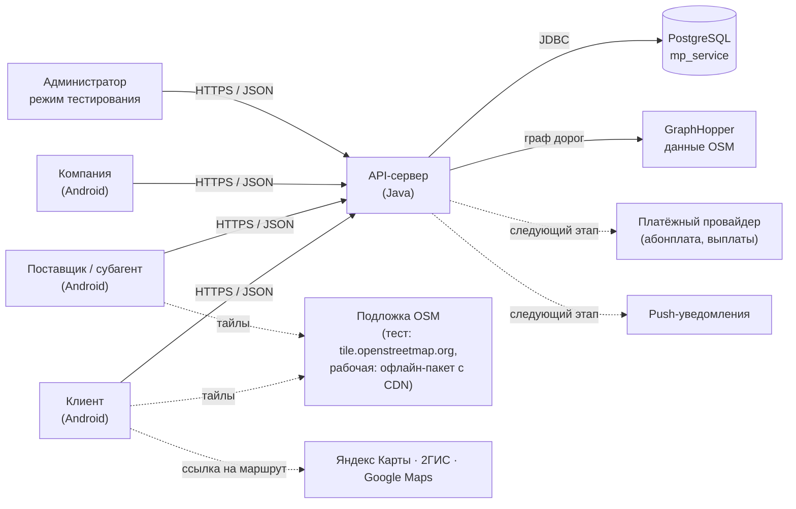

## 2. Функциональные блоки

| Блок | Что делает | Где живёт |
| --- | --- | --- |
| Каталог услуг | Дерево «категория → сервис → вариант», поиск, синонимы, пиктограммы | БД: `service`, `glossary*`, `icon`; API `/services` |
| Конфигурация сервисов | Настройки по дереву и рейтингу, поля карточек/запросов/откликов | БД: `service_setting`, `attribute`, `service_attribute`, `get_setting()` |
| Агенты и роли | Клиент, поставщик, компания, субагент, администратор; профиль с историей | БД: `agent*`; API `/me` |
| Подписки и монетизация | Пакеты, пробный период, абонплата, субагенты сверх пакета | БД: `service_package`, `agent_subscription`, `subscription_payment` |
| Рефералы | 3 уровня 10/5/2%, начисление после периода, выплата | БД: `referral_reward` |
| Публикации поставщиков | Окна доступности: место, маршрут такси | БД: `provider_slot`; API `/slots`, `/map/slots` |
| Сделки | Запрос, подбор, отклики, согласование, закрытие, отмена, сроки | БД: `deal*`, триггеры; API `/deals`, `/requests` |
| Гео и карта | Положения, зоны, смещение точек, сближение, курсоры | БД: `agent_position`, `v_deal_offer_list`; приложение: osmdroid |
| Маршрутизация | Маршрут по дорогам, коридор, направление, длина | Сервер: GraphHopper |
| Закрытие сделки | Динамический QR / ключ, тестовое подтверждение | Сервер: HMAC; приложение: QR, сканер |
| Уведомления | Новые запросы и отклики, согласование, сближение, закрытие, сроки, санкции | БД: `notification`; API `/notifications` (опрос) |
| Рейтинг и отзывы | Баллы обязательны, рейтинг по дням (0,5 системный + 0,5 отзывы) | БД: `deal_review`, `rating_history` |
| Антифрод | Сигналы, предупреждения, понижение, блокировки, уведомления компании | БД: `agent_sanction`; сервер: плановые задания |
| Конфигурация интерфейса | Шаблоны A/B/C, схемы LIGHT/DARK, контрольная сумма | БД: `ui_config`, `dictionary` (`UI_TEMPLATE`, `UI_SCHEME`); API `/config` |
| Локализация | Тексты интерфейса и уведомлений на языке агента | БД: `glossary_text`; приложение: `core/i18n` |
| Отчёты | Доходы и расходы агента и компании по дням | БД: `v_agent_finance_daily`, `v_company_finance_daily` |
| Режим тестирования | Курсор вместо GPS, QR без камеры, шестерёнка на курсоре | БД: `agent.is_testing`; API, приложение |

## 3. Компоненты и модули

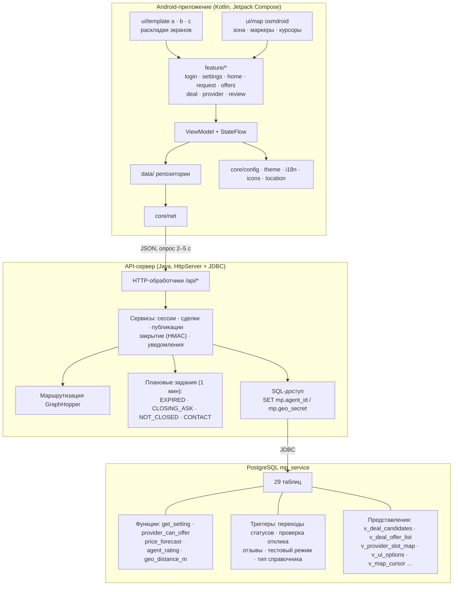

Принцип разделения:
- **БД** — источник истины по правилам: переходы статусов, допустимость отклика, отзывы, настройки. Обойти её из API или приложения нельзя.
- **API** — сессии, секреты (код закрытия, смещение точек), маршрутизация, плановые задания, сборка JSON.
- **Приложение** — отображение по шаблону, ввод, карта, положение; бизнес-правил не дублирует, берёт `actions` сделки из API.

## 4. Развёртывание

### 4.1 Прототип (локально)

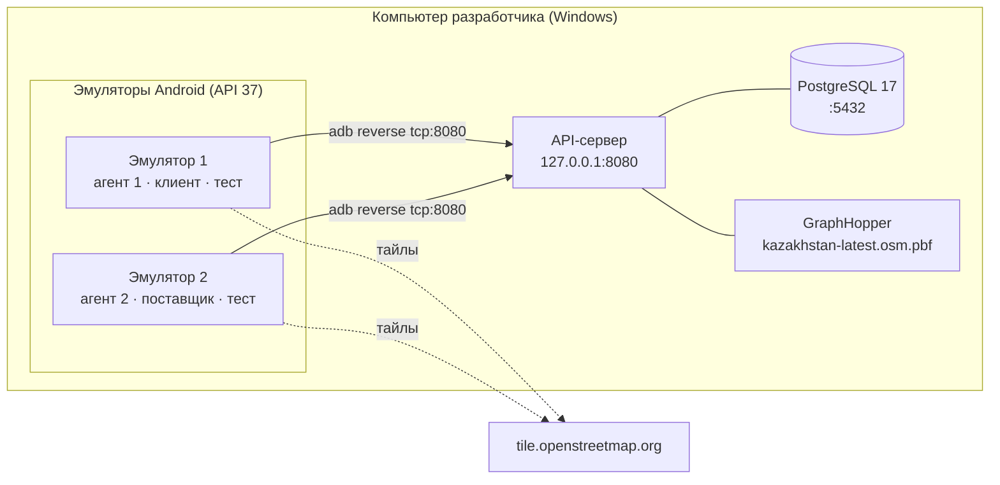

### 4.2 Рабочий контур (целевой)

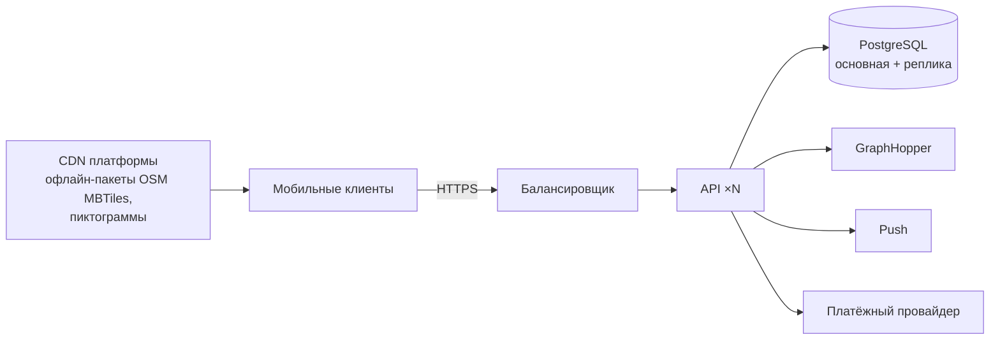

## 5. Жизненный цикл сделки

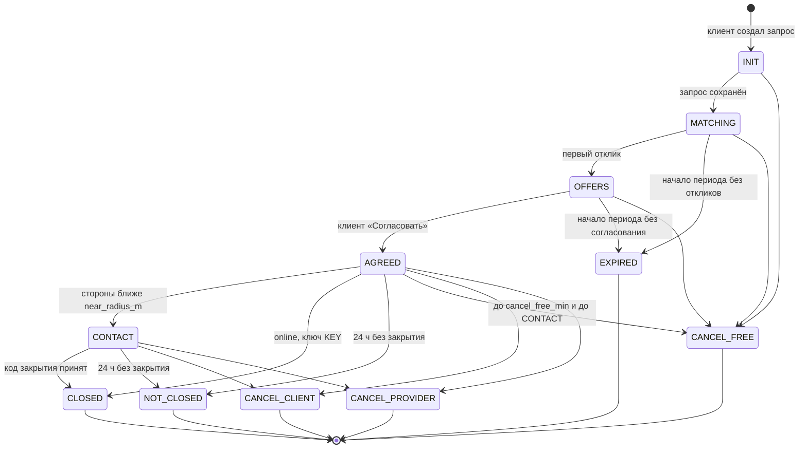

## 6. Взаимодействия

### 6.1 Публикация, запрос, отклик, согласование

```mermaid
sequenceDiagram
    autonumber
    actor P as Поставщик
    actor C as Клиент
    participant A as API
    participant D as БД
    P->>A: POST /slots (место, окно 18:00–18:30, мин. цена)
    A->>D: INSERT provider_slot
    C->>A: GET /map/slots
    A->>D: v_provider_slot_map (точки смещены)
    A-->>C: свободные места
    C->>A: POST /forecast
    A->>D: price_forecast()
    A-->>C: 700–1500, медиана 950
    C->>A: POST /deals (slot_id, период, радиус, «моя цена»)
    A->>D: проверка баллов, INSERT deal → MATCHING (триггер логирует)
    A->>D: v_deal_candidates
    A->>D: INSERT notification NEW_REQUEST поставщикам
    A->>D: автоотклики (is_auto = 1)
    P->>A: GET /notifications → GET /requests
    P->>A: POST /deals/{id}/offers (цена)
    A->>D: trg_deal_offer_check: provider_can_offer → OFFERS
    A->>D: NEW_OFFER клиенту
    C->>A: GET /deals/{id}/offers
    A-->>C: B, D, C (смещённые точки, расстояние интервалом)
    C->>A: POST /offers/{id}/agree
    A->>D: selected / declined / withdrawn, AGREED, close_secret
    A->>D: AGREED поставщику, OFFER_WITHDRAWN другим клиентам
    A-->>C: точная точка, ссылки на маршрут
```

### 6.2 Сближение и закрытие

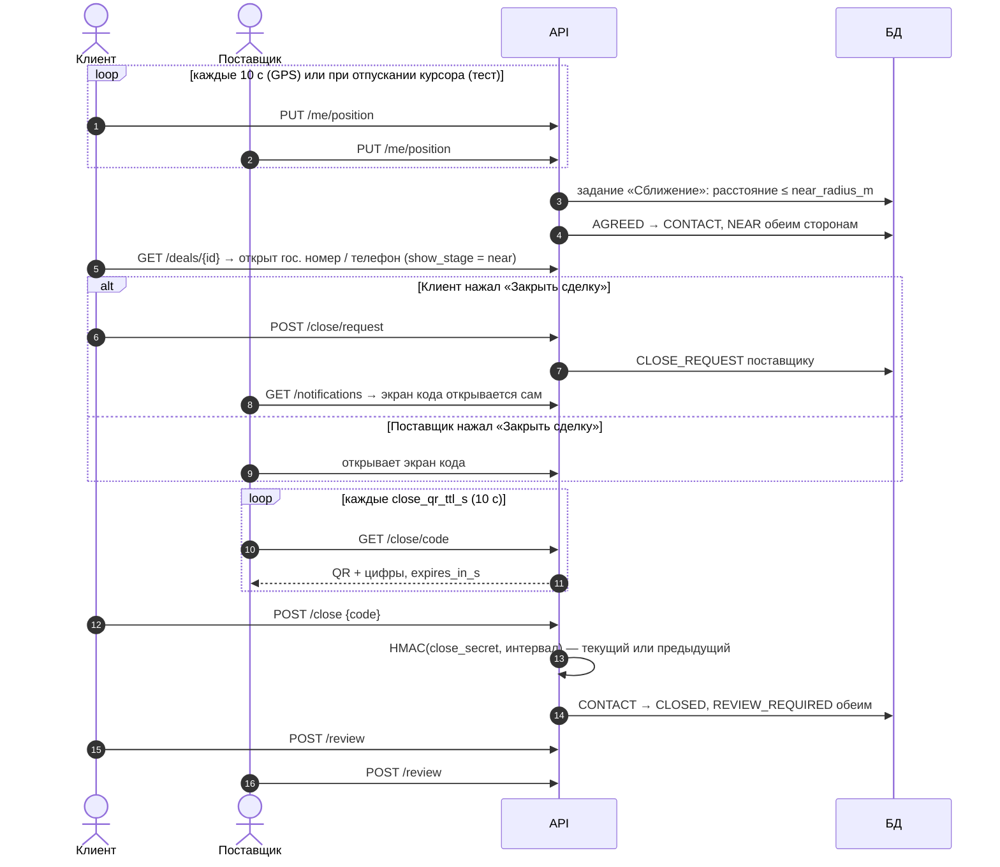

### 6.3 Режим тестирования: закрытие без камеры

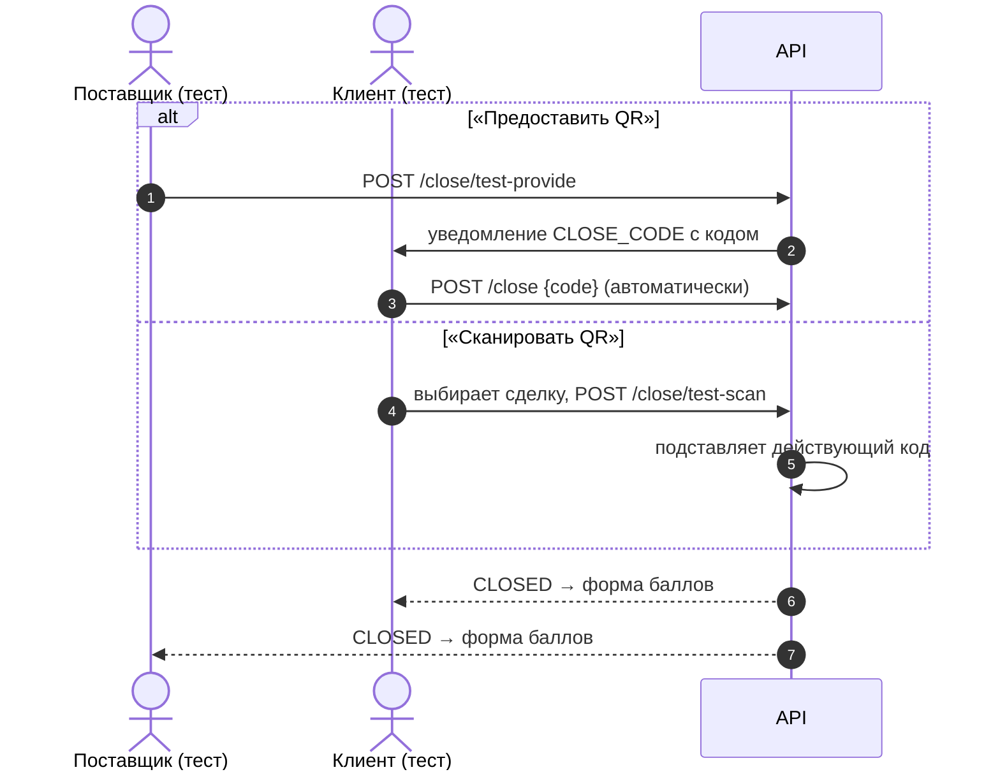

### 6.4 Подбор такси по пути

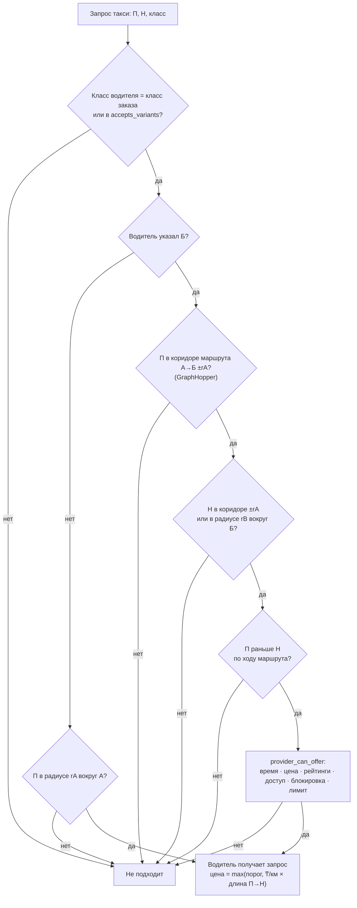

### 6.5 Загрузка конфигурации интерфейса

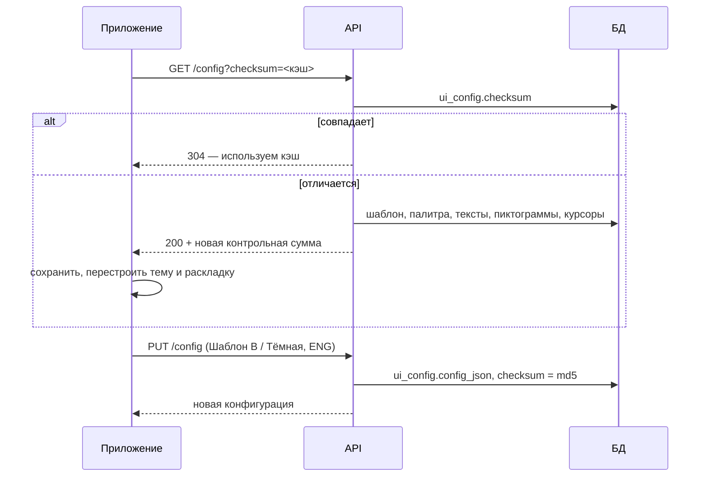

### 6.6 Антифрод

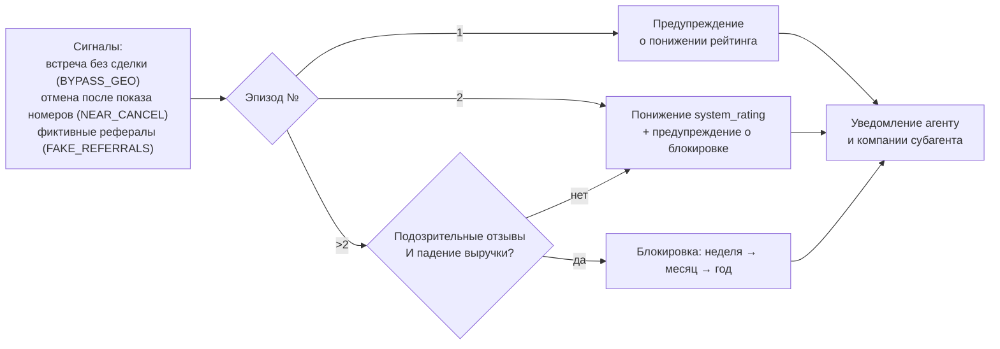

## 7. Модель конфигурации: «новый сервис — только данными»

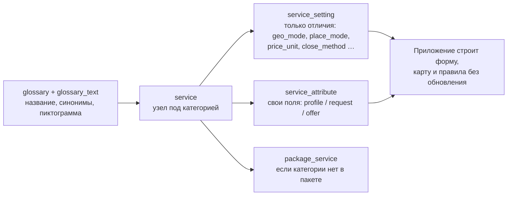

Пример: «Эвакуатор» в «Транспорт и авто» — 1 термин, 2 перевода, 1 узел, 3 настройки (`geo_mode = route`, `place_mode = client`, `price_unit = km`); поля «Гос. номер» и «Марка и цвет авто» уже есть.

## 8. Интерфейс: шаблоны и схемы

| Шаблон | Идея | Главная | Запрос | Отклики | Навигация | Шрифт |
| --- | --- | --- | --- | --- | --- | --- |
| A «Карта в центре» | Гео-сервисы: карта на весь экран, шторка снизу | карта + шторка | шторка | карта + шторка | кнопки сверху | Manrope |
| B «Карточки» | Супер-приложение: плитки, мастер по шагам | плитки | мастер | список / карта | нижнее меню | Golos Text |
| C «Диспетчер» | Плотные данные: карта + таблица, моноширинные цифры | плотный список | строки формы | карта + таблица | кнопка действия | Onest + JetBrains Mono |

Каждый шаблон — в схемах LIGHT и DARK; выбор «Шаблон / Схема» и язык — в настройках, применяются сразу. Логика и данные экранов общие, шаблон меняет только раскладку и оформление. Эскизы — холст «Эскизы маркетплейса услуг».

## 9. Нефункциональные требования

| Область | Требование |
| --- | --- |
| Безопасность | Секреты только в переменных окружения; точное место и имя поставщика до согласования не отдаются; код закрытия не выводится из данных клиента |
| Персональные данные | Поля другой стороны — по `show_stage` и статусу; номер карты не хранится (токен провайдера) |
| Карта | Подпись «© участники OpenStreetMap» всегда видна; массовая загрузка с tile.openstreetmap.org запрещена — рабочая подложка офлайн-пакетом |
| Доступность | Контраст текста ≥ 4.5:1, зоны нажатия ≥ 48 dp |
| Обновление интерфейса | Без выпуска приложения: шаблон, палитра, тексты, пиктограммы, поля и настройки сервисов — из БД |
| Масштабирование | Переход на PostGIS и push вместо опроса — при росте нагрузки |

## 10. Дорожная карта

| Этап | Содержание |
| --- | --- |
| Прототип v0.7 | Полный цикл сделки на двух эмуляторах, шаблоны A/B/C × LIGHT/DARK, режим тестирования, такси по пути |
| Следующий | Регистрация и профиль, финансовый кабинет, офлайн-пакет OSM с CDN, push, прогноз цены по спросу и предложению |
| Далее | Оплата через счёт платформы, выплаты рефералам, PostGIS, рабочий контур |
